<h1 align="center">Chess Online for PS Vita</h1>

<p align="center">
  An unofficial homebrew chess app for the PlayStation Vita.<br>
  Play the computer offline, or play people online as a guest.
</p>

<p align="center">
  <a href="https://github.com/flowoverflow/chess-online-vita/releases/latest"></a>
  
  
  <a href="LICENSE"></a>
</p>

<p align="center">
  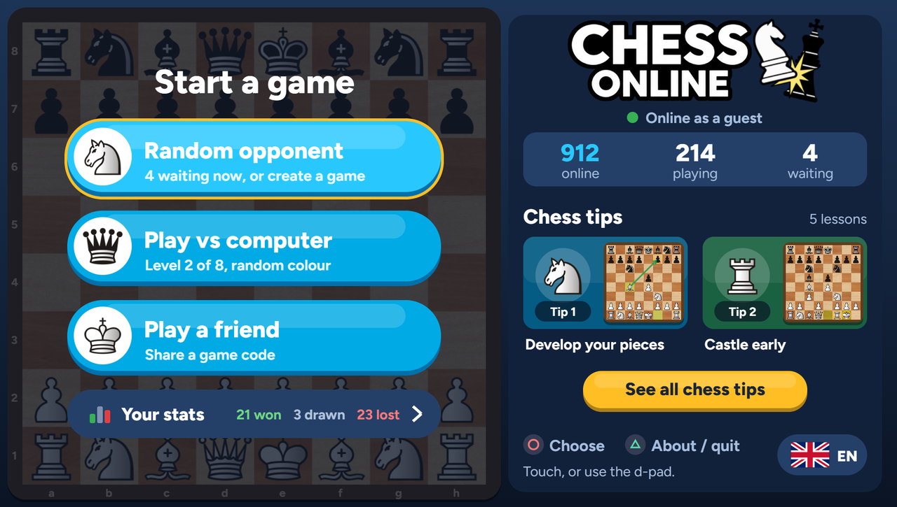
</p>

## Watch it

A one-minute tour of the app:

https://github.com/user-attachments/assets/9b80d7b5-d88e-4ba8-96ba-b64ffe1473bf

<details>
<summary><b>Watch in another language:</b> Français · 日本語 · Polski · Português do Brasil · Русский · Español</summary>

#### Français (French)

https://github.com/user-attachments/assets/b0d17924-4d09-4fdc-93d5-47c1ec3b4726

#### 日本語 (Japanese)

https://github.com/user-attachments/assets/a1e8aa6b-8d0e-4cd2-aec1-b2c8512344f9

#### Polski (Polish)

https://github.com/user-attachments/assets/d5bc9fbc-c414-4c08-ae3b-bea50fdfd42c

#### Português do Brasil (Brazilian Portuguese)

https://github.com/user-attachments/assets/576900f8-e064-4ffb-9a2d-2252307c6d53

#### Русский (Russian)

https://github.com/user-attachments/assets/eee8d474-7c69-41ae-b72e-e1ffb78bbc21

#### Español (Spanish)

https://github.com/user-attachments/assets/37f31502-fcc3-452a-93db-f69265e5762e

</details>

## Features

- **Play vs computer.** It has its own engine with eight levels. The engine runs on the Vita, so this works offline.
- **Random opponent and Play a friend.** Guest games on the public Coolmath Games chess server
  (`chess1.coolmathgames.com`). You can join a waiting game, create one, or share a six-letter code with a friend.
  The games have server clocks, takeback and rematch offers, and reconnect after a dropped connection.
- **Chess tips.** Five short lessons played out on the board.
- **Your statistics.** Kept on the Vita: results by colour, by level and by speed, streaks and recent games.
- **18 languages,** one for each system language the Vita offers. The app follows the Vita's own setting until you
  pick one in the app.
- **Updates itself.** When a new release is out, the app offers to install it. There is only ever one VPK to install.

> [!NOTE]
> This project is not affiliated with, endorsed by or connected to Coolmath Games. The app uses their guest server the
> way a guest does: no account, login, cookie or page token, an honest User-Agent
> (`ChessOnline/<version> (PS Vita homebrew; personal use)`) and no Origin header. The server can change or refuse
> this client at any time. Play vs computer, the lessons and the statistics keep working without it.

## Screenshots

<table>
  <tr>
    <td width="50%" valign="top">
      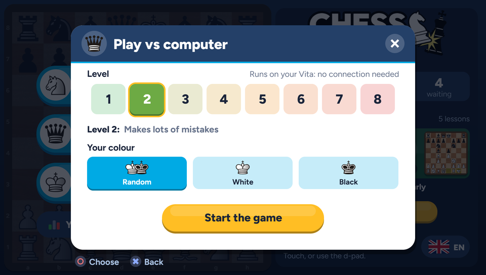
      <br><sub><b>Play vs computer.</b> Eight levels, and the engine runs on the Vita.</sub>
    </td>
    <td width="50%" valign="top">
      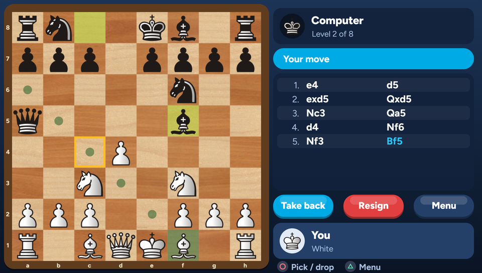
      <br><sub><b>A game against the computer,</b> with the legal moves marked.</sub>
    </td>
  </tr>
  <tr>
    <td width="50%" valign="top">
      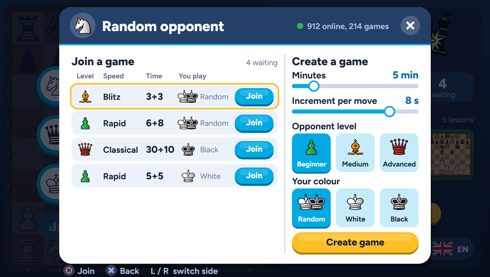
      <br><sub><b>Random opponent.</b> Join a waiting game or create your own.</sub>
    </td>
    <td width="50%" valign="top">
      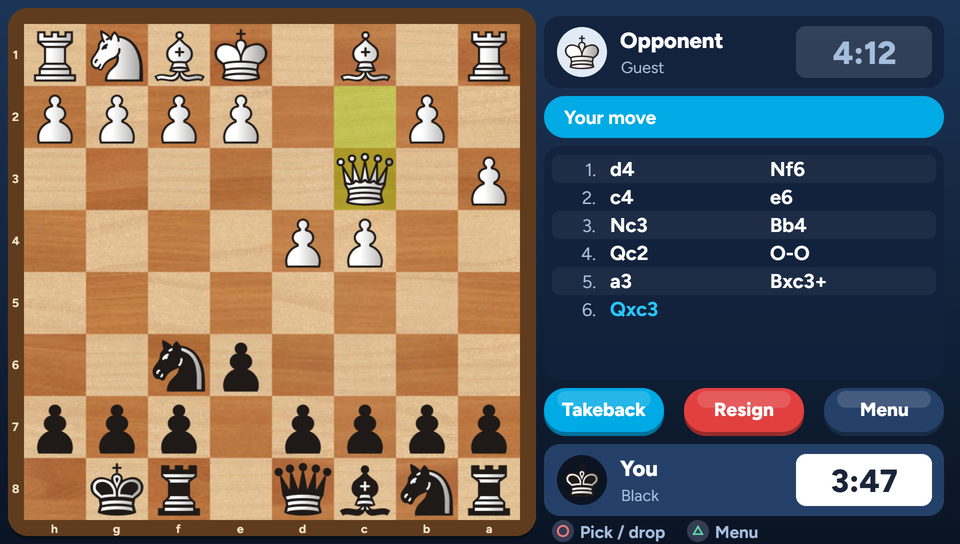
      <br><sub><b>Online games</b> with the server's clocks.</sub>
    </td>
  </tr>
  <tr>
    <td width="50%" valign="top">
      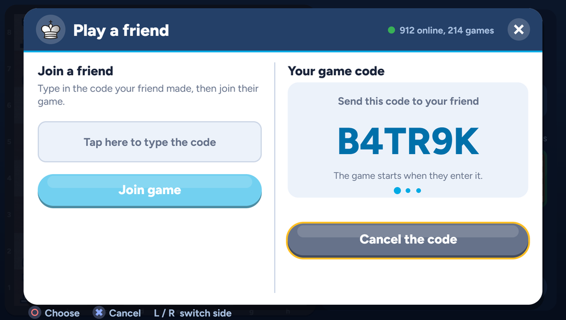
      <br><sub><b>Play a friend.</b> Send them a six-letter code.</sub>
    </td>
    <td width="50%" valign="top">
      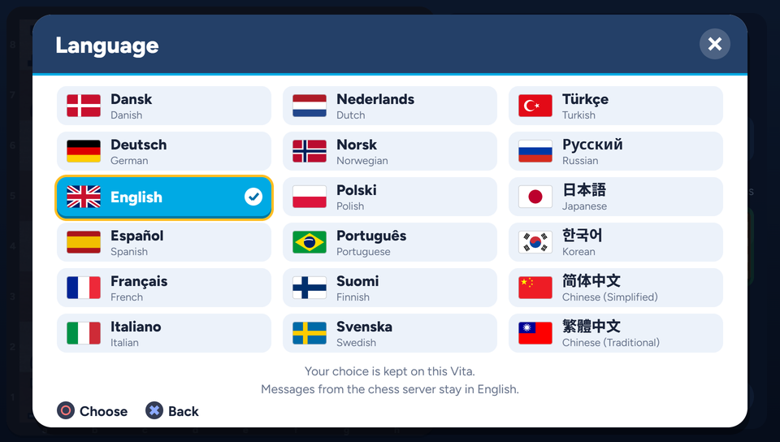
      <br><sub><b>18 languages.</b> The app starts in the Vita's own language.</sub>
    </td>
  </tr>
  <tr>
    <td width="50%" valign="top">
      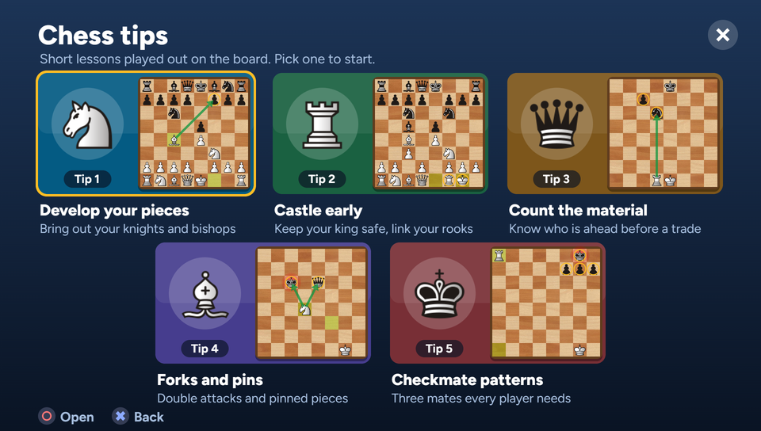
      <br><sub><b>Chess tips.</b> Five short lessons.</sub>
    </td>
    <td width="50%" valign="top">
      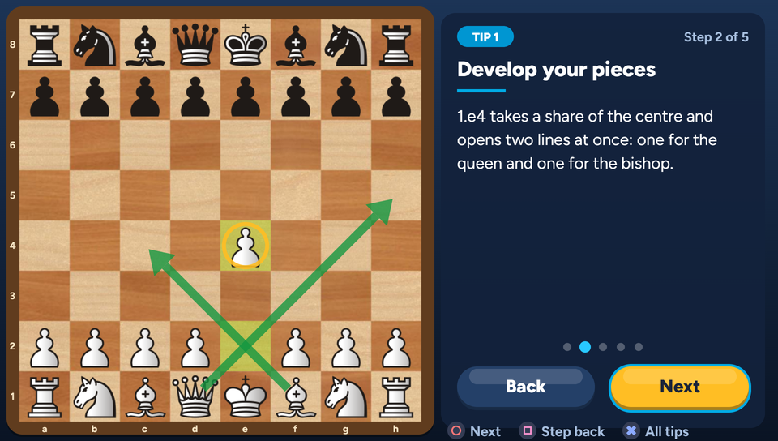
      <br><sub><b>A lesson,</b> played out on the board.</sub>
    </td>
  </tr>
  <tr>
    <td width="50%" valign="top">
      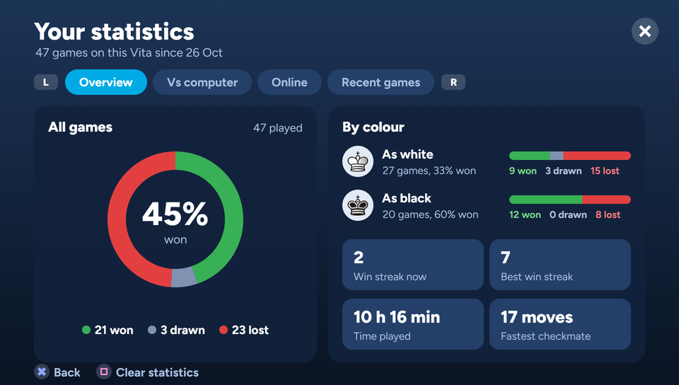
      <br><sub><b>Your statistics,</b> kept on the Vita.</sub>
    </td>
    <td width="50%" valign="top">
      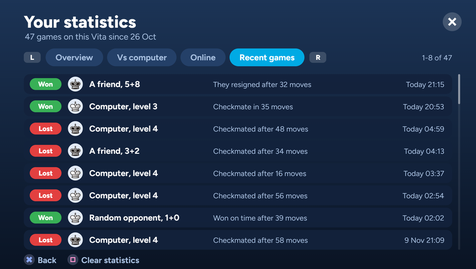
      <br><sub><b>Recent games,</b> with how each one ended.</sub>
    </td>
  </tr>
</table>

## Install

You need a PS Vita that runs homebrew, with VitaShell.

1. Download `ChessOnline-<version>.vpk` from the
   [latest release](https://github.com/flowoverflow/chess-online-vita/releases/latest) and copy it to the Vita, for
   example to `ux0:data/`.
2. Open it in VitaShell and install it. Accept the extended permissions prompt.

The app is called **Chess Online** (title ID `CHESSONL1`). Its data lives in `ux0:data/ChessOnline/`:

| File | What it holds |
|---|---|
| `settings.txt` | the computer level and colour, and the language if you picked one |
| `games.txt` | one line per finished game, for the statistics |
| `games-cleared.txt` | the statistics put aside by "Clear statistics" |
| `log.txt` | a short technical log, rotated past 512 KB |

## Updates

From 1.0.1 on, the app updates itself, and there is still only one VPK to install. To move from 1.0.0 to 1.0.1,
install the 1.0.1 VPK once with VitaShell; after that the app updates by itself:
1. At start it asks this repo's public GitHub releases for the latest version. No account and no key are needed.
2. If that version is newer, Home shows **Update available** with **Install** and **Ask me later**.
3. **Install** downloads the release's `ChessOnline-<version>.vpk`. It checks the file's size and the SHA-256 that
   GitHub lists for it, and checks that the package is Chess Online's. Then it unpacks the package into
   `ux0:data/ChessOnline/update/`.
4. A running app can't replace its own files on the Vita. So the VPK carries a small helper app, Chess Online
   Updater. The app installs the helper with the Vita's own installer and starts it.
5. The helper copies the new files into place and backs up every file it replaces. If anything fails, it puts the
   old files back. Then it reopens Chess Online.
6. Chess Online shows **Update installed**, removes the helper again and deletes the downloaded files. Your
   settings and statistics are not touched.

A release for the updater needs a `ChessOnline-<version>.vpk` asset and a tag such as `v1.0.2`. Drafts and
prereleases are skipped.

To try an update without publishing anything, use a test build: `CO_TEST_FEED=1 bash scripts/build.sh`.
- It reads the "latest release" from `ux0:data/ChessOnline/test-feed/latest.json` (GitHub's format) and the package
  from the same folder.
- A `"test_fail_after": N` field there makes its test helper stop after N files, to try the rollback.
- `CO_VERSION=0.9.9` builds an app that reports itself older, and `CO_SFO_VERSION=01.02` changes param.sfo's
  version.
- A normal build has none of this.

## Build

The build uses VitaSDK 2026.08 (the regular hard-float SDK) with the vdpm packages `curl` and `libvita2d`, which bring
OpenSSL 1.1.1, zstd, bzip2 and FreeType. It was built on Ubuntu under WSL2.

```bash
bash scripts/build.sh
```

`scripts/build.sh` uses `$VITASDK` (default `~/vitasdk-2026.08`). It writes `build/vita/chessonline.vpk` and
`build/vita/eboot.bin`. It also writes `res/cacert.pem` from Ubuntu's ca-certificates: the GTS and ISRG roots that the
chess server's certificates chain to.

The host tests build the portable code with gcc, AddressSanitizer and UndefinedBehaviorSanitizer:

```bash
bash scripts/host-tests.sh
```

They check the rules (including perft), JSON, the guest protocol, the engine, the lessons, the statistics and the
language table.

## Layout

| Path | What |
|---|---|
| `src/portable/` | code that also runs on a PC: the rules (`chess.c`), the engine, JSON, the guest-server messages and clocks (`cmg.c`), lessons, statistics, languages (`i18n.c`, `i18n_table.c`) |
| `src/vita/` | the Vita side: drawing and widgets (`ui.c`), screens, online play (`guest.c`, `net.c`: libcurl WebSocket with an HTTPS long-poll fallback), input, files |
| `tests/` | the host tests |
| `res/` | pictures, fonts and the language flags packed into the VPK, with `res/LICENSES.md` |
| `tools/cmg_check.py` | a small PC client for the guest server (Python standard library only), used as the partner in private test games |
| `src/vita/updateui.c`, `src/portable/update.c`, `unzip.c`, `sfo.c` | the updater: the release check, the dialogs, download and checks, the zip reader |
| `updater/` | Chess Online Updater, the helper app that copies an update into place; built by `scripts/build-updater.sh` and carried inside the VPK |
| `tools/headbin/` | the helper's package header (GPL-3.0, see Licence) |
| `media/` | the screenshots in this README |

## AI assistance

This project was developed with a lot of help from **Claude Code**, Anthropic's AI coding agent, running **Claude
Opus 5.5** at extra-high effort. Claude Code wrote and reviewed much of the code, the tests, the translations and the
documentation, and ran the builds and the tests on a real PS Vita. A person directed the project: the design, the
artwork and every decision about what to build. Treat it like any other hobby code: read it before you rely on it.

## Licence

- The app's own code is under the MIT licence (`LICENSE`).
- The bundled pieces, board, fonts and pictures keep their own licences. They are listed, with their sources, in
  `res/LICENSES.md`.
- The libraries linked into the app are listed in `THIRD-PARTY.md`.
- `tools/headbin/` is a separate build tool under the **GPL-3.0**, derived from VitaShell. It makes the helper app's
  package header, `res/updater/sce_sys/package/head.bin`, which is under the GPL-3.0 too. The app only copies that
  file; no GPL code is compiled into it. See `tools/headbin/README.md`.
